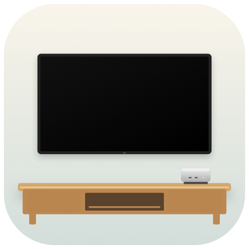

<p align="center">
  
</p>
<h1 align="center">Couch Cube</h1>
<p align="center"><strong>Your Mac Console</strong></p>
<p align="center">
  Turn your Mac into a big-screen gaming console.<br>
  Bring a controller. Invite your friends. Make room for game night.
</p>
<p align="center">
  <a href="https://github.com/marosige/couch-cube/releases"><strong>Get Couch Cube</strong></a>
  &nbsp;·&nbsp; Apple Silicon &nbsp;·&nbsp; macOS 13+
</p>

Couch Cube walks you through setting up **Steam games and retro classics**
in a few simple steps. Play from **Steam Big Picture**, browse your retro
collection with **ES-DE**, and connect up to **4 controllers** in supported games.

## Where will you play?

| On this Mac | On an external SSD |
|---|---|
| One Mac, one cozy gaming spot. | More room for games on smaller Macs, such as 256 GB models — or take your app and games between Macs. |
| Open the **DMG** and drag **Couch Cube** onto **Applications**. | Unzip the **SSD pack** onto the SSD and configure **Settings → Game library**. Or use the installed app → **Settings → Game library → Add or prepare an SSD** to copy the app or explicitly prepare a new SSD. |

Downloads are on the [Releases](https://github.com/marosige/couch-cube/releases) page.
Couch Cube is in early testing (alpha): back up your data first. Some game players require newer macOS.

**"Apple could not verify CouchCube.app…"** Couch Cube is not notarized by Apple yet, so macOS
blocks the first launch. If **Open Anyway** in System Settings → Privacy & Security doesn't help,
copy the app to Applications, then run this once in Terminal (it asks for your Mac password):

```sh
sudo xattr -dr com.apple.quarantine /Applications/CouchCube.app
```

This only removes the "downloaded from the internet" mark from Couch Cube; nothing else changes.

## What you get

- **Play** — open your TV menu (Steam Big Picture or ES-DE), or start any game from one launcher:
  Steam games, Windows launchers like Battle.net, Mac launchers, emulators and apps you add.
- **Controllers** — see, name, order and test up to 4 controllers; pairing stays in macOS Bluetooth settings.
- **Game library** — keep games on this Mac or on an external SSD you can take to another Mac.
- **App Store** — install, update and remove Steam, store launchers and emulators (via Homebrew where possible).
- **Retro consoles** — choose which consoles appear in ES-DE and check which BIOS files are still missing.
- **Console Mode** — optionally open your TV menu automatically when a controller is connected at login.
- **Cube Shop** — browse PC game deals, free giveaways and Mac App Store games, keep a wishlist with target
  prices. It never buys anything or signs in; every link opens in your browser.

Couch Cube includes no games, BIOS, firmware or keys. How each page works in detail is described in
[DESIGN.md](DESIGN.md).


## Console choices

| Systems | Required app | Additional setup |
|---|---|---|
| GameCube, Wii | Dolphin | Your game dumps and controller setup |
| Wii U | Cemu, manual download from [cemu.info](https://cemu.info/) | Configure Cemu; the Homebrew `cemu` calculator cask is **not** used |
| PlayStation 1 and classic consoles | RetroArch | Required core from RetroArch's Core Downloader, your own BIOS where required |
| PlayStation 2 | PCSX2 | Your own PS2 BIOS; current Homebrew build may require Rosetta |
| PlayStation 3 | RPCS3, manual download from [rpcs3.net](https://rpcs3.net/download) | Install Sony firmware in RPCS3; game compatibility varies |
| Nintendo Switch | Manually supplied compatible Ryujinx-based macOS build (`Ryujinx.app`) | No verified automatic download bundled; configure your own legally obtained keys, firmware and game dumps |

These are launch integrations, not game compatibility guarantees. Every console
has its folder in `ROMs` from the start, so you can copy games in before turning it on. Disabling a
console preserves its ROMs and saves. Existing disabled ROM folders get ES-DE's
`noload.txt` marker; only Couch Cube's unchanged markers are removed when
re-enabling. The managed frontend disables gamelist-only loading so these
markers are respected. Quit ES-DE before changing console selection or
updating frontend settings. Installed app icons are read from the apps on
your Mac; missing apps use system-symbol placeholders.

---

## For the curious

**What's inside:** a native macOS app with its own Python runtime.
No developer tools or separate Python install needed to run it. Homebrew
helps install optional game players. This isn't a bootable OS or macOS Proton.

**Your library:** APFS or Mac OS Extended storage. Files live in
`~/Games/Couch Cube` locally, or `<SSD>/Couch Cube` for portable
setups. Keep the portable app beside that folder. After moving it, use
**Game library → Update library links**; Steam links may need reconnecting too.
Storage checks aren't speed tests or game-compatibility guarantees.

**SSD preparation:** stages this running app on another disk and verifies its
signature before erasing, then copies the app to the SSD root. No network or
separate portable download is needed. Verification failure means no erase.
**Copy this app to SSD** copies it without erasing anything and refuses to
overwrite an existing copy.
Internal disks and the disk running the app are protected; uncertain disk
identity requires Disk Utility instead. A failure after erasure can't restore
your data. **Details** opens the activity log.

**Updates:** checked on launch, installed by you. Download, quit the app and
replace your copy. Offline use works. Builds are ad-hoc signed; checksums
and signatures check integrity, not publisher identity. Releases contain one
DMG; GitHub's asset digest provides download verification without separate
checksum attachments. A local checksum file is still generated for developers.

**Uninstall:** in App Store, click an app's Remove button, then confirm.
Homebrew-managed apps use Homebrew uninstall without `--zap`; manual apps go
to Trash. Games, saves and emulator preferences are kept. **Settings →
Uninstall Couch Cube** removes this copy, its login entry, saved Mac selection
and login log, while preserving game-library folders and other installed apps.
This intentionally does not recursively delete your games or emulator data.

**Settings → Clean up gaming setup → Review…** is a separate, broader cleanup.
It shows an unchecked list with exact paths for detected launchers, emulators,
Steam libraries, connected Couch Cube libraries (including ROMs, BIOS and saves),
known Blizzard game folders, Windows bottles, settings, caches and logs. This
includes software installed before Couch Cube. Select only items you want removed,
back up important files, quit games and launchers, and type `REMOVE` to confirm.
The list is revalidated before cleanup. Homebrew-managed apps are uninstalled
without `--zap`; other selected items use macOS Trash. Failures are reported in
Activity, including partial cleanup. You can also remove this copy of Couch Cube.
Removing Couch Cube settings disables its automatic console mode.

Cleanup does not empty Trash, erase drives, remove Homebrew or Rosetta, or run
global dependency/cache cleanup. Shared dependencies are kept because other
software may need them; dependencies bundled inside selected apps and bottles
leave with those items. Custom locations, disconnected drives, other users'
files, cloud saves and unrecognized gaming software are not removed. Review
those separately rather than assuming cleanup guarantees a game-free Mac.

**Automatic console mode:** enable it in **Settings → Console Mode** on each Mac. After login,
wait 5–300 seconds (30 by default). With no keyboard or mouse connected, a
USB or Bluetooth controller opens your default TV menu,
even if connected later. Save this setting again after changing
the selected game library; older Steam-only login entries also need re-saving
to use ES-DE fallback.
A keyboard or mouse skips auto-launch for that login. macOS still requires
your normal login; Couch Cube never changes passwords or automatic login.

For an optional couch-only startup, Console Mode links to macOS Users & Groups,
FileVault and Lock Screen settings and Apple's automatic-login guide. A separate
**Standard** Couch Cube account with its own password can keep gaming settings
apart from a private administrator account. Put the app in `/Applications`, then
configure storage, launcher sign-ins and automatic console mode from the gaming
account. Existing private-account libraries are not moved or automatically shared.
Choose that account in macOS's **Automatically log in as** setting; removing its
password is not required. FileVault prevents automatic login. Disabling it reduces
startup protection for the entire Mac, including private accounts; a separate
gaming account does not replace that protection. Sleep/screen-lock authentication
is a separate macOS setting. Couch Cube does not change any of these protections
or create users, and organization policies may prohibit automatic login.
Keep the app at its saved location, with its SSD connected at login. After
moving the app, save the setting again. Disable Steam's own login startup to
avoid a second launch. Turn this feature off in Console Mode to remove its login
entry; allow background activity in macOS Login Items if prompted. Logs are in
`~/Library/Logs/Couch Cube/auto-launch.log`.

**Icon:** [Compact, M4-style Mac mini close-up](assets/icon.svg) with a low,
rectangular case and an unmarked lid, two left USB-C ports and a right headphone jack with
the white LED immediately to its left. A lowered oak cabinet leaves space beneath
the wall-mounted TV. The icon is shared
by the app and DMG. The [portable artwork](assets/portable-icon.svg) adds a
front-connected USB SSD, not a badge. SVGs and 128/512/1024 px PNGs are in `assets/`.

### Build from source

On macOS with Apple Command Line Tools and Python 3.9+:

```sh
bash scripts/setup.sh                  # Build and open
bash scripts/package-release.sh        # DMG, SSD pack ZIP and a local checksum in build/
bash scripts/build-icons.sh --export   # Export artwork
/usr/bin/python3 -B -m unittest discover -s tests -q
/usr/bin/python3 -B scripts/verify-release.py "build/$(python3 scripts/version.py get dmg)"
```

The first build downloads a pinned runtime (`config/runtime.json`).
Each build clears `build/` first except the current `CouchCube.app` and release DMG/ZIP files.
The app is built in `build/staging/CouchCube.app` and then swapped into `build/CouchCube.app` in
one atomic rename, so a copy that's already running never sees a half-built bundle
(`scripts/build-setup-app.sh --stage-only` stops after staging). If the bundle is replaced
anyway, Couch Cube asks you to quit and reopen instead of showing a raw Python error.

The native app is `setup/CouchCube/` (one file per area; `SetupController.swift` holds the
window state and `SetupController+<Area>.swift` the behavior). The backend is `scripts/console.py`
and its helper modules, run by the bundled Python.

### Versions and releases

Couch Cube uses [Semantic Versioning](https://semver.org): `MAJOR.MINOR.PATCH`, with
`-alpha.N`, `-beta.N` or `-rc.N` for test builds (for example `0.1.0-alpha.1`).
The version lives only in `config/release.json`; `scripts/version.py bump alpha|beta|rc|patch|minor|major|release`
changes it and the build number. When a new version reaches `main`, the Release workflow builds and verifies
the DMG and SSD pack, then publishes `v<version>` — test builds as GitHub pre-releases, stable versions as Latest.
Test builds of the app look for newer test builds and stable releases; stable builds only for stable releases.
Running the Release workflow by hand builds and verifies without publishing.
