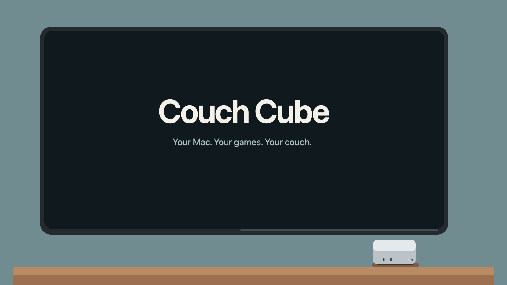

<p align="center">
  
</p>
<h1 align="center">Couch Cube</h1>
<p align="center"><strong>Your Mac. Your games. Your couch.</strong></p>
<p align="center">
  Turn your Mac into a big-screen gaming console.<br>
  Bring a controller. Invite your friends. Make room for game night.
</p>
<p align="center">
  <a href="https://github.com/marosige/couch-cube/releases"><strong>Get Couch Cube</strong></a>
  &nbsp;·&nbsp; Apple Silicon &nbsp;·&nbsp; macOS 13+
</p>

Couch Cube walks you through setting up **Steam games and retro classics**
in a few simple steps. Play from **Steam Big Picture**, browse your retro
collection with **ES-DE**, and connect up to **4 controllers** in supported games.

## Where will you play?

| On this Mac | On an external SSD |
|---|---|
| One Mac, one cozy gaming spot. | More room for games on smaller Macs, such as 256 GB models — or take your app and games between Macs. |
| Open the **DMG** and drag **CouchCube.app** to Applications. | Unzip the **SSD pack** onto the SSD and finish Setup. Or use the installed app → **Setup → External SSD** to copy the app or explicitly prepare a new SSD. |

Downloads appear once the first [release](https://github.com/marosige/couch-cube/releases)
is published. Some game players require newer macOS.

## What setup actually does

The interface is for people new to Mac gaming: show a short status and the next
useful action first. Keep technical explanations in details or Activity rather
than crowding the main pages.
Apps rows show the app name, Installed/Not installed and a short purpose;
emulators list only their consoles. Install uses an appearance-aware gray pill-shaped **Get**
button with accent-colored text; **Update** uses the same style and **Remove**
is a white circular button with a red minus. All have tooltips and accessible labels. An available update keeps Remove alongside it;
the status shows a yellow dot and **Installed · Update available**.
Apps groups each category in its own rounded card, ordered **TV menus**,
**PC games**, **Windows games**, then **Retro games**.
removal still asks for confirmation. Version details are available on hover.

**Website:** [marosige.github.io/couch-cube](https://marosige.github.io/couch-cube/).
The app's Couch Cube branding opens this page. It links to the newest published
release (including alpha releases) with an Installer DMG and SSD pack ZIP.
For the SSD pack, unzip its contents onto your SSD, open `CouchCube.app` and
finish Setup before adding games. The empty `Couch Cube` folders are a template:
Setup checks and binds them to the current volume; it does not erase the SSD.
A modified template with extra files is preserved rather than overwritten.
Emulators, games and BIOS are not included.

The static site lives in `site/`; the Pages workflow adds the app icon and deploys
on changes pushed to `main`. Enable **Settings → Pages → Source: GitHub Actions**
in the repository before the first deployment. Downloads fall back to Releases
when a release asset is unavailable or GitHub's API cannot be reached.

**One window, no wizard.** Overview opens first with an overview of storage,
TV-menu availability, active controllers, selected consoles and login launch
settings. It distinguishes detected readiness from manual game/BIOS/account
checks instead of claiming the whole setup has been verified.
Setup stays in the sidebar, alongside Play, Game
library, Apps, TV menu, Controllers, Consoles, Steam setup, and Settings. Nothing is installed
or erased until you confirm it. Storage is checked on launch, explicit refresh,
volume changes and returning to Overview—not whenever the app gains focus.
Returning to Overview keeps the last results visible while refreshing in the
background. Unknown gray statuses become a pulsing blue **Checking...** indicator.
Known statuses keep their text with a pulsing blue dot during refresh (static
when Reduce Motion is enabled); failures are marked in the same status line.
Read-only storage checks validate the volume before and after
the batch instead of rediscovering every disk for each managed file.

The sidebar groups everyday console actions, games and devices, and this Mac's
preferences in an inset, rounded panel containing the native window controls.
The sidebar uses the same solid background as the right-hand section cards,
not wallpaper transparency or blur, in both light and dark appearances.
The title stays hidden.
The current page title appears only in the top bar beside a native grouped
Back/Forward control, not repeated in the page content. Overview starts directly
with its status rows, without an essentials score or summary heading.
Overview rows open the relevant page with a chevron, with status below each name:
green means yes/ready, red means no/off, yellow means partial setup, and gray
means unknown. Controllers show four indicators, green for connected controllers
and gray for empty slots, in a shared dark pill-shaped LED housing alongside
the actual connected count.
Hovering an Overview row highlights its full width with a rounded accent fill.
Overview links to Play, Setup, Game library, Apps, TV menu, Controllers,
Console visibility, Steam setup and Settings. Apps summarizes installed PC
game apps (including the CurseForge addon manager) and emulators separately;
these are app counts, not installed game counts. The Apps categories distinguish
**PC games** (official macOS launchers) from **Windows games**
(tools for supported Windows games on this Mac). Windows games lists Porting Kit
and CrossOver together. Existing CrossOver installations in `/Applications` or
`~/Applications` are detected and can be opened directly. Otherwise Install opens
CodeWeavers' official site; use your existing license or its trial. Games and
bottles are configured in CrossOver, and compatibility is not guaranteed.
Named sections and row separators organize apps and console families.
Compact switches sit on the right. Status dots always have text: green means
ready/connected, yellow means setup or connection is needed, and red marks a
library problem. Console switches alone indicate whether a system is enabled.
Enabled consoles also show BIOS filename-check results. Their info page lists
each expected filename, destination and Found/Not found state in the selected
storage's `BIOS/retroarch` folder. PS1 accepts any listed alternative; Sega CD
reports regional BIOS files separately; Dreamcast BIOS files are optional.
Systems that need no BIOS say so. PCSX2, RPCS3 and Switch emulator-managed BIOS,
firmware or keys are marked as manual, not falsely reported as missing.
Only file presence is checked, not contents, hashes or authenticity. No BIOS is
downloaded; supply only your own legally obtained dumps.
Console rows show only the emulator name with a readiness dot: gray when hidden,
green when the emulator and required BIOS are available, red when the emulator
or required BIOS is missing, and yellow when an optional BIOS has a fallback.
Emulator-managed firmware that cannot be checked stays gray rather than claiming
readiness. The info button explains the next step, links to Apps and shows BIOS
filenames to copy individually or with **Copy all**, plus a copyable console-name
search and Google search button. Copying never downloads or moves a BIOS file.
Nintendo shares one rounded card with Home consoles and Handhelds sections;
PlayStation and SEGA each have their own card.

1. **Create game folders in Setup.** Choose this Mac or an SSD. This creates Couch Cube's
   folders and launcher files only: no apps are installed, no games are moved,
   and Steam's settings are unchanged.
2. **Choose Consoles and Apps.** Switch on only the systems you want; new
   libraries start with none selected. Switch changes save automatically and are the
   only on/off indicator. Systems have original hardware-inspired icons without
   manufacturer logos. Nintendo home consoles (including the hybrid Switch) and
   Nintendo handhelds have separate sections; each section lists systems by their
   first release, oldest first, as do PlayStation and SEGA.
   In **Apps**, rows show installed versions, status and purpose, with **Install**,
   **Remove** or **Update** directly on the right, without an app detail page.
   PC game launchers include Steam, GOG Galaxy, EA app, Epic Games Launcher and
   the official interactive Battle.net installer. Only each launcher's supported
   macOS games are native; Windows-only games do not become compatible automatically.
   CurseForge appears immediately below Battle.net for WoW addon management.
   Choose the WoW installation and manage addons in CurseForge itself.
   The TV menus category shares Steam Big Picture's installation with Steam.
   Console rows show only the emulator,
   an info button for requirements and the enable switch.
   Opening Apps or TV menu checks installed versions and Homebrew-managed updates.
   **Update all** confirms and updates only the listed outdated Homebrew-managed apps,
   stopping on errors. Nothing is installed or upgraded merely by opening a page.
   Steam and manual installations also have their own in-app updaters.
   If Homebrew is missing, finish its installer first, then click Install again.
   **Activity remains available during installation**, with live Homebrew output.

3. **Finish in Steam.** Sign in, install a game and connect a controller.
   For local play, keep Steam's existing/default library—no storage change is
   required. To use the SSD or Couch Cube's `SteamLibrary` folder, add it
   yourself in **Steam → Settings (Preferences) → Storage → Add Drive**.
   Choose another location and select the SSD's `Couch Cube/SteamLibrary`.
   Steam may label it Macintosh HD too: check its path. Rename its display label **Console Port**
   if Steam offers that option, and choose **Make Default**. Existing games
   stay in place unless you use Steam's **Move** action. Couch Cube does not
   edit Steam's library database; these settings have no supported public
   automation interface.

**Steam integration:** Overview and Game library show installed Steam game counts
on local and external volumes. Game library lists names, manifest-reported install/
update state and recorded size; Steam setup summarizes each library and path.
Disconnected libraries show Offline rather than a misleading zero count. Partial
or unreadable metadata is explicitly reported. These are local Steam manifests,
not account ownership, live download progress or a compatibility check. Counts
exclude entries that Steam does not mark fully installed. Refresh is read-only
and needs no Steam password, API key or SteamCMD installation.
**Open Steam Storage** opens the client's storage settings; use Steam to set a
default library, rename its display label or move games. SteamCMD's
`force_install_dir` controls SteamCMD downloads, not the desktop client's settings.
No verified official end-user library-management CLI is integrated for GOG Galaxy,
EA, Epic or Battle.net; their own apps still manage games and accounts.

**TV menu:** Choose **Make default** for installed Steam Big Picture or ES-DE.
The preference is stored on this Mac, independently of game storage. Play and
automatic console mode use it; a missing chosen menu reports an error instead of
silently opening another. Without an explicit choice, Steam is preferred, then ES-DE.
The future Couch Cube menu is shown as disabled/coming soon.
Play has a large default-menu action plus separate Steam Big Picture and ES-DE
buttons, which launch without changing the default. Couch Cube Launcher is
shown there as coming soon too.

Consoles controls system visibility in ES-DE, not emulator installation. The future
Couch Cube menu will use the same saved selection. Steam's own library is unchanged.

**Setup** shows your current storage and suggested next actions. **Steam setup**
shows the exact storage path and manual steps; Couch Cube does not verify
Steam sign-in, controller configuration or completion of those steps.

**Controllers** combines paired Bluetooth controllers, connected USB/Bluetooth
game controllers and previously seen devices under **Connected Controllers**.
Green means connected, gray means disconnected; connected entries show
**Wired** or **Bluetooth** (other transports are labeled separately).
Choose the pencil to save a custom name and icon color in Couch Cube. The original
device/Bluetooth name remains below a custom name. Names do not rename the device
in macOS or Steam. **Show connected first** brings connected devices to the top;
switching it off restores the original order. Names, colors and order persist on
this Mac. Devices without a serial number may be identified by USB port; changing
ports can create a separate entry. Devices with no stable identity are session-only.

**Searching...** opens macOS Bluetooth pairing, while the list refreshes every two
seconds only on this page. Bluetooth access is requested only when you choose
**Allow Bluetooth access**. USB devices do not need Bluetooth access. Some
Bluetooth LE pairings are only exposed in macOS Settings; the page says so.
No private pairing APIs or Bluetooth-database edits are used.

**Controller test** shows the custom name and incoming button, D-pad or
stick/trigger signal, and briefly marks the exact device row receiving input.
Button numbers are hardware numbers, not a promised Steam/console mapping.
The test monitors only gamepad/joystick devices, uses no exclusive capture and
stops when leaving Controllers. Input-access failures are shown explicitly.
**Controller settings** opens macOS's Game Controllers page.
Retro games still need your own ROMs, any required BIOS and emulator cores.
Add `Launchers/Retro.app` or registered game shortcuts to Steam through
**Games → Add a Non-Steam Game to My Library → Browse**; this is not automatic.
Without an explicit default, Steam Big Picture is preferred when Steam is installed.
With ES-DE selected (or installed without Steam), **Play** opens ES-DE using this library's retro configuration
instead. ES-DE still needs the appropriate emulators, games and any BIOS/cores.
Decky is not included or supported
on macOS. Windows games need compatible, individually configured wrappers,
not macOS Proton.

### Console choices

| Systems | Required app | Additional setup |
|---|---|---|
| GameCube, Wii | Dolphin | Your game dumps and controller setup |
| Wii U | Cemu, manual download from [cemu.info](https://cemu.info/) | Configure Cemu; the Homebrew `cemu` calculator cask is **not** used |
| PlayStation 1 and classic consoles | RetroArch | Required core from RetroArch's Core Downloader, your own BIOS where required |
| PlayStation 2 | PCSX2 | Your own PS2 BIOS; current Homebrew build may require Rosetta |
| PlayStation 3 | RPCS3, manual download from [rpcs3.net](https://rpcs3.net/download) | Install Sony firmware in RPCS3; game compatibility varies |
| Nintendo Switch | Manually supplied compatible Ryujinx-based macOS build (`Ryujinx.app`) | No verified automatic download bundled; configure your own legally obtained keys, firmware and game dumps |

These are launch integrations, not game compatibility guarantees. Disabling a
console preserves its ROMs and saves. Existing disabled ROM folders get ES-DE's
`noload.txt` marker; only Couch Cube's unchanged markers are removed when
re-enabling. The managed frontend disables gamelist-only loading so these
markers are respected. Quit ES-DE before changing console selection or
updating frontend settings. Installed app icons are read from the apps on
your Mac; missing apps use system-symbol placeholders.

---

## For the curious

**What's inside:** a native macOS app with its own Python runtime.
No developer tools or separate Python install needed to run it. Homebrew
helps install optional game players. This isn't a bootable OS or macOS Proton.

**Your library:** APFS or Mac OS Extended storage. Files live in
`~/Games/Couch Cube` locally, or `<SSD>/Couch Cube` for portable
setups. Keep the portable app beside that folder. After moving it, use
**Game library → Update library links**; Steam links may need reconnecting too.
Storage checks aren't speed tests or game-compatibility guarantees.

**SSD preparation:** stages this running app on another disk and verifies its
signature before erasing, then copies the app to the SSD root. No network or
separate portable download is needed. Verification failure means no erase.
**Copy this app to SSD** copies it without erasing anything and refuses to
overwrite an existing copy.
Internal disks and the disk running the app are protected; uncertain disk
identity requires Disk Utility instead. A failure after erasure can't restore
your data. **Details** opens the activity log.

**Updates:** checked on launch, installed by you. Download, quit the app and
replace your copy. Offline use works. Builds are ad-hoc signed; checksums
and signatures check integrity, not publisher identity. Releases contain one
DMG; GitHub's asset digest provides download verification without separate
checksum attachments. A local checksum file is still generated for developers.

**Uninstall:** in Apps, click an app's Remove button, then confirm.
Homebrew-managed apps use Homebrew uninstall without `--zap`; manual apps go
to Trash. Games, saves and emulator preferences are kept. **Settings →
Uninstall Couch Cube** removes this copy, its login entry, saved Mac selection
and login log, while preserving game-library folders and other installed apps.
This intentionally does not recursively delete your games or emulator data.

**Automatic console mode:** enable it in **Settings** on each Mac. After login,
wait 5–300 seconds (30 by default). With no keyboard or mouse connected, a
USB or Bluetooth controller opens your default TV menu,
even if connected later. Save this setting again after changing
the selected game library; older Steam-only login entries also need re-saving
to use ES-DE fallback.
A keyboard or mouse skips auto-launch for that login. macOS still requires
your normal login; Couch Cube never changes passwords or automatic login.
Keep the app at its saved location, with its SSD connected at login. After
moving the app, save the setting again. Disable Steam's own login startup to
avoid a second launch. Turn this feature off in Settings to remove its login
entry; allow background activity in macOS Login Items if prompted. Logs are in
`~/Library/Logs/Couch Cube/auto-launch.log`.

**Icon:** [Compact, M4-style Mac mini close-up](assets/icon.svg) with a low,
rectangular case and an unmarked lid, two left USB-C ports and a right headphone jack with
the white LED immediately to its left. A lowered oak cabinet leaves space beneath
the wall-mounted TV. The icon is shared
by the app and DMG. The [portable artwork](assets/portable-icon.svg) adds a
front-connected USB SSD, not a badge. SVGs and 128/512/1024 px PNGs are in `assets/`.

### Build from source

On macOS with Apple Command Line Tools and Python 3.9+:

```sh
bash scripts/setup.sh                  # Build and open
bash scripts/package-release.sh        # One DMG and a local checksum in build/
bash scripts/build-icons.sh --export   # Export artwork
/usr/bin/python3 -B -m unittest discover -s tests -q
/usr/bin/python3 -B scripts/verify-release.py \
  build/CouchCube-0.3.0-arm64.dmg
```

The first build downloads a pinned runtime (`config/runtime.json`).
Each build clears `build/` first, including previous apps, releases and caches.
Update settings live in `config/release.json`. The manual GitHub workflow
builds downloads; publishing a release is a separate, explicit action.
Pushing a `v0.3.0-alpha.N` tag builds and verifies that tagged commit, then
publishes a GitHub prerelease with only the DMG attachment.
Alpha builds retain internal version `0.3.0`. Stable-only in-app release
discovery does not show alpha releases. SSD copying uses the running app
and works offline, including in alpha builds.
